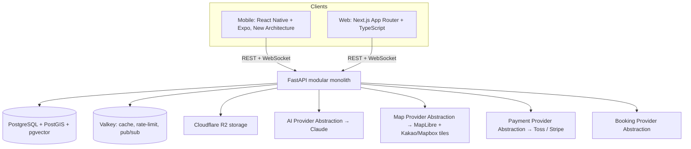

# Architecture — SIDEQUEST

## 1. System overview



One deployable backend (a modular monolith), one primary datastore, and four
provider-abstraction seams (AI, maps, payments, bookings) that exist because
the product spec requires multi-provider, multi-region support from the
start, not as a future refactor.

## 2. Backend modules

One package per concern, each with its own router / service / repository
layers. Modules import only through other modules' public interfaces — no
reaching into another module's ORM models directly. This is what makes any
module extractable into its own service later without a rewrite, if scale
ever demands it (see [ROADMAP.md](ROADMAP.md) Phase 9).

```
services/api/app/
├── auth/               # registration, login, JWT verification (Supabase-issued)
├── users/               # user CRUD, settings
├── profiles/             # bio, avatar, visibility settings, XP/level cache
├── friends/               # friend requests, blocks
├── quests/                 # quest CRUD, discovery, nearby search
├── quest_participants/      # join/leave, participant status
├── quest_objectives/         # objective definitions + verification methods
├── quest_completion/          # check-in, completion, XP award trigger
├── matching/                    # compatibility scoring
├── recommendations/              # rule-based → content-based → collaborative → ML → LLM-assisted
├── ai/                             # AIService abstraction: QuestGenerator, Recommender, etc.
├── chat/                             # quest room messages, WebSocket fan-out
├── notifications/                     # in-app + push, preference management
├── businesses/                          # business accounts, sponsorship
├── creators/                              # creator profiles, quest templates
├── marketplace/                             # paid quest purchase, revenue split
├── payments/                                  # PaymentProvider abstraction (Toss/Stripe)
├── bookings/                                    # BookingProvider abstraction
├── gamification/                                  # XP ledger, levels, achievements
├── moderation/                                      # reports, admin actions
└── analytics/                                         # event tracking, North Star dashboards
```

Matches the product spec's module list (§29) exactly — no modules were added
or dropped for Phase 0; several simply have no routes wired until their
phase arrives (e.g. `bookings` ships empty until Phase 7).

## 3. Key architectural decisions

- **Modular monolith, not microservices.** One deployable, one database,
  clean module boundaries. Avoids the distributed-systems tax (service
  discovery, distributed transactions, cross-service observability) before
  there's a scale problem that justifies it. The product spec explicitly
  rules out microservices for v1 (§48).
- **PostgreSQL + PostGIS + pgvector, one engine for three jobs.** Relational
  integrity for social/financial data (friends, payments, the XP ledger),
  efficient "quests near me" geo queries via PostGIS, and the vector
  similarity search Phase 3 recommendations need via pgvector — no second
  datastore to operate, back up, or pay for. See [DATABASE.md](DATABASE.md).
- **WebSockets for quest rooms.** Chat, presence, and objective-status all
  need low-latency bidirectional updates; REST polling doesn't match the
  "temporary live group" feel the product needs. Fan-out is backed by
  Valkey pub/sub so multiple API instances can share room state.
- **Four provider abstractions (AI, maps, payments, bookings).** Each is a
  single interface with one adapter per real provider
  (`services/api/app/ai/providers/anthropic.py`, etc.). This exists because
  Phase 2 (Kakao Maps, Toss Payments, Claude) and later international phases
  (Google Maps/Mapbox, Stripe, alternate LLMs) are both real requirements —
  writing the seam once now is cheaper than retrofitting it later.
- **Monorepo (pnpm + Turborepo).** Mobile, web, and the shared design-token/
  i18n/type packages need to stay in lockstep; Turborepo's caching keeps
  that affordable as the repo grows past Phase 2.
- **Dev-cost posture.** `infra/docker-compose.yml` runs real Postgres,
  Valkey, and MinIO locally — not managed services — during Phase 2–4
  build-out, so development costs ~$0. Because every external dependency
  sits behind an abstraction or a standard protocol (S3 API, Redis API), the
  swap to managed Supabase/R2/Stripe for staging and production is a config
  change, not a rewrite.

## 4. Technology choices (current best fit, not just "a" fit)

| Concern | Pick | Why it's the current best fit |
|---|---|---|
| Mobile | React Native + Expo (New Architecture/Fabric default, Expo Router) | New Architecture is now stable and the Expo default — faster, better native-module interop than the old bridge |
| Web | Next.js App Router + TypeScript | Industry standard; RSC + Server Actions cut API boilerplate for simple reads |
| Backend | FastAPI + Pydantic v2 + SQLAlchemy 2.0 (async) + asyncpg | Async end-to-end (needed for WebSocket quest rooms); Pydantic v2's Rust core is far faster than v1 |
| Database | PostgreSQL + PostGIS + pgvector | One database for relational + geo + vector search |
| Cache / pub-sub | **Valkey** (Redis-API-compatible) | Redis Inc. moved Redis itself to a source-available license in 2024; Valkey is the Linux-Foundation-backed, truly open-source fork with the same API — no licensing risk for a commercial product |
| Object storage | **Cloudflare R2** (prod) / MinIO (local dev) | S3-API-compatible with **zero egress fees** — quest photos/videos get expensive fast on egress-billed storage at scale |
| Monorepo tooling | pnpm workspaces + Turborepo | Fast installs with correct hoisting; incremental, cached builds across apps + packages |
| Client state | TanStack Query (server state) + Zustand (UI state) | Current standard replacing Redux for new RN/Next apps |
| Styling / design tokens | Tailwind CSS (web) + NativeWind v4 (RN), one shared config | NativeWind runs on the New Architecture and consumes the *same* Tailwind config as web — a literal single source of truth |
| Maps | **MapLibre GL** (open-source renderer) + Kakao Maps SDK (KR) → Mapbox/MapTiler (intl) | Mapbox GL JS went proprietary-licensed; MapLibre is the open-source fork with no per-load licensing risk |
| Payments | **Toss Payments** (Korea) + Stripe (international) | Toss is the current standard for Korean startups; Stripe covers international — both behind one abstraction |
| AI / LLM | Claude (Anthropic API), default provider behind `AIService` | Strong instruction-following and tool-use for structured quest-JSON generation; swappable |
| Embeddings | Voyage AI → pgvector | Pairs directly with the pgvector column already in Postgres for Phase 3 recommendations |
| Auth | Supabase Auth (managed user table + JWT) | Email/social login without hand-rolling auth; FastAPI just verifies the JWT |
| i18n | next-intl (web) + i18next/react-i18next (RN) | Current best-practice library per framework, both reading `packages/i18n` |
| CI/CD | GitHub Actions | Free at this scale, native to the chosen git workflow |
| Hosting — web | Vercel | Built by the Next.js team, zero-config, generous free tier |
| Hosting — backend | Fly.io or Railway | Cheapest real Docker deployment with managed Postgres/Valkey add-ons |
| Mobile builds | EAS (Expo Application Services) | Cloud builds + OTA updates, no owned Mac build infra |
| Error tracking | Sentry | One SDK across RN/Next/FastAPI, generous free tier |
| Product analytics | PostHog | Open-source/self-hostable; covers event tracking + funnels + North Star dashboards (§35) in one tool |
| Web E2E | Playwright | Current standard for web E2E |
| Mobile E2E | Maestro | Simpler, less flaky than Detox for Expo/RN today |

## 5. Internationalization

Korean, English, Japanese, and Chinese are supported from Phase 2 onward.
**No UI string is ever hardcoded in application code** — every string is a
key resolved from `packages/i18n/{locale}.json`, consumed via `next-intl` on
web and `i18next`/`react-i18next` on mobile. Database content that's
inherently structured (interest names, category names, achievement names)
stores an i18n *key*, never display text — see `interests.key` and
`quest_objectives.description_key` in [DATABASE.md](DATABASE.md).

## 6. Real-time layer

Quest rooms use one WebSocket connection per client
(`WS /api/v1/ws/quests/{id}`), authenticated with the same JWT as REST calls.
Valkey pub/sub fans messages out across API instances so room state isn't
pinned to a single backend process — this is what lets the backend scale
horizontally in Phase 9 without a quest-room rewrite.

## 7. Related docs

[DATABASE.md](DATABASE.md) · [API.md](API.md) · [AI.md](AI.md) ·
[SECURITY.md](SECURITY.md) · [DEPLOYMENT.md](DEPLOYMENT.md)
