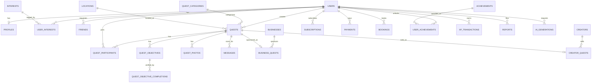

# Database — SIDEQUEST

PostgreSQL, with the `postgis` and `pgvector` extensions enabled. Schema is
managed with Alembic migrations against SQLAlchemy 2.0 (async) models in
`services/api/app/*/models.py`.

## Conventions

- **Primary keys:** UUIDv7 (time-ordered UUID) everywhere, generated
  application-side. UUIDv7 keeps B-tree index locality close to a sequential
  integer (unlike UUIDv4's random scatter) while staying non-enumerable —
  the right default for a public-facing social app in 2026.
- **Timestamps:** `created_at TIMESTAMPTZ NOT NULL DEFAULT now()` and
  `updated_at TIMESTAMPTZ NOT NULL DEFAULT now()` (updated via trigger or ORM
  `onupdate`) on every table.
- **Soft deletion:** `deleted_at TIMESTAMPTZ NULL` on user-facing content
  (`users`, `quests`, `messages`, `quest_photos`) so moderation/safety
  investigations retain data even after a user "deletes" it. Hard deletion is
  a separate, explicit admin/GDPR-style erasure path, not the default.
- **Money:** `NUMERIC(12,2)` + a `currency CHAR(3)` (ISO 4217) column
  alongside any amount — never a bare float, never currency-implied-by-context.
- **Enums:** Postgres native `ENUM` types for closed sets (`quest.status`,
  `friend.status`, etc.); `TEXT` + application validation for open/extensible
  sets (report reasons) so adding one doesn't require a migration.

## Entity-relationship overview



## Identity & social

*A few fields below (`phone`, `auth_provider_ref`, `geog` later in this
file) reflect the original Phase 0 design intent rather than what's
actually running — auth is self-issued JWT, not Supabase (see
docs/ARCHITECTURE.md), and there's no PostGIS on this dev setup (see
docs/DEPLOYMENT.md §Local dev without Docker). Called out here rather
than silently left for someone to trip over; a full pass reconciling
this whole file with the real schema is still owed, not done in this
pass — `email_verified_at` and `email_tokens` below **are** current.*

```sql
CREATE TABLE users (
    id                 UUID PRIMARY KEY,
    email              CITEXT UNIQUE,
    phone              TEXT UNIQUE,
    auth_provider_ref  TEXT NOT NULL,        -- Supabase Auth subject id
    username           CITEXT UNIQUE NOT NULL,
    locale             TEXT NOT NULL DEFAULT 'en',   -- ko | en | ja | zh
    status             user_status NOT NULL DEFAULT 'active', -- active|suspended|deactivated
    is_admin           BOOLEAN NOT NULL DEFAULT false,  -- no signup flow, see app/make_admin.py
    email_verified_at  TIMESTAMPTZ,   -- non-blocking (docs/SECURITY.md) — set via POST /auth/verify-email
    created_at         TIMESTAMPTZ NOT NULL DEFAULT now(),
    updated_at         TIMESTAMPTZ NOT NULL DEFAULT now(),
    deleted_at         TIMESTAMPTZ   -- self-service via POST /users/me/delete; also mangles email/username to free them for reuse
);

CREATE TABLE email_tokens (
    id           UUID PRIMARY KEY,
    user_id      UUID NOT NULL REFERENCES users(id) ON DELETE CASCADE,
    purpose      email_token_purpose NOT NULL,   -- verify_email | reset_password
    token_hash   TEXT UNIQUE NOT NULL,   -- SHA-256 of the raw token — only the hash is ever stored
    created_at   TIMESTAMPTZ NOT NULL DEFAULT now(),
    expires_at   TIMESTAMPTZ NOT NULL,   -- 24h for verify_email, 1h for reset_password
    used_at      TIMESTAMPTZ    -- single-use: NULL until consumed, then never reusable
);
-- Backs POST /auth/verify-email and /auth/forgot-password + /auth/reset-password.
-- See app/security.py::generate_email_token / hash_email_token.

CREATE TABLE profiles (
    user_id             UUID PRIMARY KEY REFERENCES users(id) ON DELETE CASCADE,
    display_name        TEXT NOT NULL,
    real_name            TEXT,                 -- nullable, opt-in visibility
    bio                   TEXT,
    avatar_url             TEXT,
    birth_date              DATE,
    visibility_settings      JSONB NOT NULL DEFAULT '{}',  -- per-field visibility
    xp                        INTEGER NOT NULL DEFAULT 0,   -- denormalized cache
    level                       INTEGER NOT NULL DEFAULT 1,  -- derived from xp
    ai_credits                   INTEGER NOT NULL DEFAULT 0,   -- Phase 6 — a plain wallet, not a ledger; see app/services/ai_quota_service.py
    updated_at                   TIMESTAMPTZ NOT NULL DEFAULT now()
);
-- xp/level are a read cache. Source of truth is xp_transactions (below);
-- never UPDATE xp directly from application code outside that trigger/service.
-- ai_credits has no such ledger — unlike xp there's no anti-cheat/audit
-- need, so app/routers/ai.py mutates it directly.

CREATE TABLE interests (
    id        UUID PRIMARY KEY,
    key       TEXT UNIQUE NOT NULL,   -- i18n lookup key, e.g. "interest.dance"
    category  TEXT NOT NULL
);

CREATE TABLE user_interests (
    user_id     UUID REFERENCES users(id) ON DELETE CASCADE,
    interest_id UUID REFERENCES interests(id) ON DELETE CASCADE,
    weight      REAL NOT NULL DEFAULT 1.0,
    PRIMARY KEY (user_id, interest_id)
);

CREATE TABLE friends (
    id             UUID PRIMARY KEY,
    requester_id   UUID NOT NULL REFERENCES users(id) ON DELETE CASCADE,
    addressee_id   UUID NOT NULL REFERENCES users(id) ON DELETE CASCADE,
    status         friend_status NOT NULL DEFAULT 'pending', -- pending|accepted|blocked
    created_at     TIMESTAMPTZ NOT NULL DEFAULT now(),
    responded_at   TIMESTAMPTZ,
    CHECK (requester_id <> addressee_id)
);
-- App layer enforces one row per unordered pair (checks both directions
-- before insert) rather than a DB constraint, since "pair order" is
-- meaningful for who-requested-whom but duplicate-prevention is not.

CREATE TABLE blocks (
    id          UUID PRIMARY KEY,
    blocker_id  UUID NOT NULL REFERENCES users(id) ON DELETE CASCADE,
    blocked_id  UUID NOT NULL REFERENCES users(id) ON DELETE CASCADE,
    created_at  TIMESTAMPTZ NOT NULL DEFAULT now(),
    UNIQUE (blocker_id, blocked_id)
);
-- Independent of `friends` — you can block without ever having been friends.
```

## Location, quests, objectives

```sql
CREATE TABLE locations (
    id           UUID PRIMARY KEY,
    lat          DOUBLE PRECISION NOT NULL,
    lng          DOUBLE PRECISION NOT NULL,
    geog         GEOGRAPHY(POINT, 4326) NOT NULL,  -- PostGIS, generated from lat/lng
    place_name   TEXT,
    address      TEXT,
    city         TEXT NOT NULL,
    country      CHAR(2) NOT NULL   -- ISO 3166-1 alpha-2
);
CREATE INDEX locations_geog_gix ON locations USING GIST (geog);

CREATE TABLE quest_categories (
    id          UUID PRIMARY KEY,
    key         TEXT UNIQUE NOT NULL,  -- i18n key, e.g. "category.food"
    icon        TEXT NOT NULL,
    sort_order  INTEGER NOT NULL DEFAULT 0
);

CREATE TABLE quests (
    id                 UUID PRIMARY KEY,
    creator_id         UUID NOT NULL REFERENCES users(id),
    creator_type       creator_type NOT NULL DEFAULT 'user', -- user|business|creator|ai
    category_id        UUID NOT NULL REFERENCES quest_categories(id),
    title              TEXT NOT NULL,
    description        TEXT NOT NULL,
    visibility         quest_visibility NOT NULL DEFAULT 'public', -- public|friends|private
    location_id        UUID NOT NULL REFERENCES locations(id),
    start_time         TIMESTAMPTZ NOT NULL,
    duration_minutes   INTEGER NOT NULL,
    budget_amount      NUMERIC(12,2),
    currency           CHAR(3) NOT NULL DEFAULT 'KRW',
    max_participants   SMALLINT NOT NULL,
    difficulty         quest_difficulty NOT NULL, -- easy|medium|hard|epic
    status             quest_status NOT NULL DEFAULT 'draft',
                       -- draft|open|full|in_progress|completed|cancelled
    price_amount       NUMERIC(12,2),        -- non-null only for paid creator quests
    xp_reward          INTEGER NOT NULL,
    created_at         TIMESTAMPTZ NOT NULL DEFAULT now(),
    updated_at         TIMESTAMPTZ NOT NULL DEFAULT now(),
    deleted_at         TIMESTAMPTZ
);
CREATE INDEX quests_status_start_idx ON quests (status, start_time);
CREATE INDEX quests_open_idx ON quests (start_time) WHERE status = 'open';

CREATE TABLE quest_participants (
    id            UUID PRIMARY KEY,
    quest_id      UUID NOT NULL REFERENCES quests(id) ON DELETE CASCADE,
    user_id       UUID NOT NULL REFERENCES users(id) ON DELETE CASCADE,
    status        participant_status NOT NULL DEFAULT 'joined',
                  -- joined|checked_in|completed|left|removed
    joined_at     TIMESTAMPTZ NOT NULL DEFAULT now(),
    checked_in_at TIMESTAMPTZ,
    completed_at  TIMESTAMPTZ,
    UNIQUE (quest_id, user_id)
);
CREATE INDEX quest_participants_quest_status_idx ON quest_participants (quest_id, status);
-- This table IS the M:N join between users and quests.

CREATE TABLE quest_objectives (
    id                 UUID PRIMARY KEY,
    quest_id           UUID NOT NULL REFERENCES quests(id) ON DELETE CASCADE,
    order_index        SMALLINT NOT NULL,
    description_key    TEXT NOT NULL,   -- i18n key or free text for user-authored quests
    verification_type  verification_type NOT NULL,
                       -- manual|photo|qr|geofence|business_confirm
    is_required        BOOLEAN NOT NULL DEFAULT true
);

CREATE TABLE quest_objective_completions (
    id                  UUID PRIMARY KEY,
    objective_id        UUID NOT NULL REFERENCES quest_objectives(id) ON DELETE CASCADE,
    user_id              UUID NOT NULL REFERENCES users(id) ON DELETE CASCADE,
    evidence_photo_id     UUID REFERENCES quest_photos(id),
    verified               BOOLEAN NOT NULL DEFAULT false,
    verified_at             TIMESTAMPTZ,
    verification_method      TEXT NOT NULL,  -- manual|photo|qr|geofence|business_confirm|ai_vision(Phase 8)
    UNIQUE (objective_id, user_id)
);

CREATE TABLE quest_completions (
    id            UUID PRIMARY KEY,
    quest_id      UUID NOT NULL REFERENCES quests(id) ON DELETE CASCADE,
    user_id       UUID NOT NULL REFERENCES users(id) ON DELETE CASCADE,
    completed_at  TIMESTAMPTZ NOT NULL DEFAULT now(),
    xp_awarded    INTEGER NOT NULL,
    UNIQUE (quest_id, user_id)
);

CREATE TABLE quest_photos (
    id                 UUID PRIMARY KEY,
    quest_id           UUID NOT NULL REFERENCES quests(id) ON DELETE CASCADE,
    user_id            UUID NOT NULL REFERENCES users(id) ON DELETE CASCADE,
    storage_key        TEXT NOT NULL,   -- R2/MinIO object key
    uploaded_at         TIMESTAMPTZ NOT NULL DEFAULT now(),
    moderation_status    moderation_status NOT NULL DEFAULT 'pending',
    deleted_at             TIMESTAMPTZ
);
```

## Business & creator

Built in Phase 5 (docs/ROADMAP.md). `users` also gained a Phase-5 column
not in the original Phase 0 ERD: `is_admin BOOLEAN NOT NULL DEFAULT false`
— there's no admin signup flow; it's flipped via
`uv run python -m app.make_admin <email>` (see services/api/README.md).
It gates `POST /admin/businesses/{id}/verify` and `GET /admin/businesses`
today (app/deps.py::CurrentAdmin).

```sql
CREATE TABLE businesses (
    id                   UUID PRIMARY KEY,
    owner_user_id        UUID NOT NULL REFERENCES users(id),
    name                 TEXT NOT NULL,
    category             TEXT NOT NULL,
    verification_status  business_verification_status NOT NULL DEFAULT 'pending',
                         -- pending|verified|rejected
    location_id          UUID NOT NULL REFERENCES locations(id),
    description           TEXT,
    created_at             TIMESTAMPTZ NOT NULL DEFAULT now(),
    updated_at              TIMESTAMPTZ NOT NULL DEFAULT now()
);

CREATE TABLE business_quests (
    id                 UUID PRIMARY KEY,
    business_id        UUID NOT NULL REFERENCES businesses(id) ON DELETE CASCADE,
    quest_id           UUID NOT NULL UNIQUE REFERENCES quests(id) ON DELETE CASCADE,
    sponsorship_type   sponsorship_type NOT NULL, -- sponsored|discount|challenge
    discount_details   JSONB   -- free-form: {"description": "..."} today, shown verbatim on the quest detail page
);

CREATE TABLE creators (
    id               UUID PRIMARY KEY,
    user_id          UUID NOT NULL UNIQUE REFERENCES users(id),
    display_name     TEXT NOT NULL,
    follower_count   INTEGER NOT NULL DEFAULT 0
);

-- creator_quests, subscriptions, payments below were built in Phase 6
-- (docs/ROADMAP.md) — schema matches the original Phase 0 ERD closely;
-- see docs/API.md's Creator marketplace / Subscriptions & AI credits
-- sections for the endpoints that read/write them, and
-- app/services/subscription_service.py + ai_quota_service.py for the
-- business logic.
CREATE TABLE creator_quests (
    id                  UUID PRIMARY KEY,
    creator_id          UUID NOT NULL REFERENCES creators(id) ON DELETE CASCADE,
    quest_id            UUID NOT NULL UNIQUE REFERENCES quests(id) ON DELETE CASCADE,
    price_amount        NUMERIC(12,2) NOT NULL,
    revenue_share_pct   SMALLINT NOT NULL  -- creator's share; platform keeps the remainder — fixed at 70, not creator-configurable yet
);
```

## Commerce

```sql
CREATE TABLE subscriptions (
    id                    UUID PRIMARY KEY,
    user_id               UUID NOT NULL REFERENCES users(id),
    plan                  subscription_plan NOT NULL, -- free|pro — in practice only "pro" rows are ever inserted; "free" is the absence of a row
    status                subscription_status NOT NULL, -- active|canceled
    current_period_start  TIMESTAMPTZ NOT NULL,
    current_period_end    TIMESTAMPTZ NOT NULL,
    provider_ref          TEXT   -- Toss/Stripe subscription id ("fake_..." under the dev-default PaymentProvider)
);

CREATE TABLE payments (
    id            UUID PRIMARY KEY,
    user_id       UUID NOT NULL REFERENCES users(id),
    type          payment_type NOT NULL, -- subscription|quest_purchase|booking|ai_credits
    amount        NUMERIC(12,2) NOT NULL,
    currency      CHAR(3) NOT NULL,
    provider      TEXT NOT NULL,          -- "fake" (dev/test default) | "toss" | "stripe"
    provider_ref  TEXT NOT NULL,
    status        payment_status NOT NULL, -- succeeded|failed — written even on a declined charge, for the audit trail
    created_at    TIMESTAMPTZ NOT NULL DEFAULT now()
);

-- Built in Phase 7 (docs/ROADMAP.md). provider is "fake" today (no real
-- booking vendor was ever named — see app/bookings/); commission_amount
-- is a fixed 15% of amount, computed server-side from the provider's own
-- confirmed price, never a client-supplied one.
CREATE TABLE bookings (
    id                   UUID PRIMARY KEY,
    quest_id             UUID REFERENCES quests(id),  -- nullable: a booking can stand alone, not every one is quest-tied
    user_id              UUID NOT NULL REFERENCES users(id),
    provider             TEXT NOT NULL,   -- booking provider adapter name — "fake" today
    provider_booking_ref TEXT NOT NULL,
    status               booking_status NOT NULL, -- confirmed|cancelled
    amount               NUMERIC(12,2) NOT NULL,
    commission_amount    NUMERIC(12,2) NOT NULL,
    created_at           TIMESTAMPTZ NOT NULL DEFAULT now()
);
```

## Gamification

```sql
CREATE TABLE achievements (
    id        UUID PRIMARY KEY,
    key       TEXT UNIQUE NOT NULL,  -- i18n key + lookup key
    icon      TEXT NOT NULL,
    criteria  JSONB NOT NULL          -- machine-evaluable unlock condition
);

CREATE TABLE user_achievements (
    user_id         UUID REFERENCES users(id) ON DELETE CASCADE,
    achievement_id  UUID REFERENCES achievements(id) ON DELETE CASCADE,
    unlocked_at     TIMESTAMPTZ NOT NULL DEFAULT now(),
    PRIMARY KEY (user_id, achievement_id)
);

CREATE TABLE xp_transactions (
    id                UUID PRIMARY KEY,
    user_id           UUID NOT NULL REFERENCES users(id) ON DELETE CASCADE,
    delta             INTEGER NOT NULL,           -- can be negative (moderation reversal)
    reason            TEXT NOT NULL,               -- "quest_completion" | "objective" | "admin_adjustment" ...
    related_quest_id  UUID REFERENCES quests(id),
    created_at        TIMESTAMPTZ NOT NULL DEFAULT now()
);
-- Append-only ledger = source of truth for XP. profiles.xp/level are a
-- cache recomputed from this table (via service call or trigger), never
-- written independently.
```

## Communication, safety, AI

```sql
CREATE TABLE notifications (
    id          UUID PRIMARY KEY,
    user_id     UUID NOT NULL REFERENCES users(id) ON DELETE CASCADE,
    type        TEXT NOT NULL,
    payload     JSONB NOT NULL,
    read_at     TIMESTAMPTZ,
    created_at  TIMESTAMPTZ NOT NULL DEFAULT now()
);

CREATE TABLE messages (
    id          UUID PRIMARY KEY,
    quest_id    UUID NOT NULL REFERENCES quests(id) ON DELETE CASCADE, -- the room IS the quest
    sender_id   UUID NOT NULL REFERENCES users(id),
    content     TEXT NOT NULL,
    created_at  TIMESTAMPTZ NOT NULL DEFAULT now(),
    deleted_at  TIMESTAMPTZ
);
CREATE INDEX messages_quest_created_idx ON messages (quest_id, created_at);
-- No separate quest_rooms table: a quest has exactly one room for its
-- lifetime, so quest_id doubles as room id. Revisit only if Phase 8+
-- introduces rooms that outlive or span multiple quests.

CREATE TABLE reports (
    id            UUID PRIMARY KEY,
    reporter_id   UUID NOT NULL REFERENCES users(id),
    target_type   report_target_type NOT NULL, -- user|quest|business|message
    target_id     UUID NOT NULL,
    reason        TEXT NOT NULL,
    status        report_status NOT NULL DEFAULT 'open', -- open|actioned|dismissed
    created_at    TIMESTAMPTZ NOT NULL DEFAULT now(),
    resolved_at   TIMESTAMPTZ,
    resolved_by   UUID REFERENCES users(id)   -- admin
);

CREATE TABLE ai_generations (
    id              UUID PRIMARY KEY,
    user_id         UUID NOT NULL REFERENCES users(id),
    type            TEXT NOT NULL, -- quest_generation|recommendation|matching
    prompt_context  JSONB NOT NULL,  -- structured inputs only: location, budget,
                                     -- interests — never a raw chat transcript with PII
    result          JSONB NOT NULL,
    provider        TEXT NOT NULL,   -- "anthropic"
    tokens_used     INTEGER,
    created_at      TIMESTAMPTZ NOT NULL DEFAULT now()
);

CREATE TABLE recommendations (
    id          UUID PRIMARY KEY,
    user_id     UUID NOT NULL REFERENCES users(id),
    quest_id    UUID NOT NULL REFERENCES quests(id),
    score       REAL NOT NULL,
    reason      JSONB NOT NULL,   -- component scores, see MATCHING in ARCHITECTURE.md
    shown_at    TIMESTAMPTZ NOT NULL DEFAULT now(),
    action      TEXT  -- shown|clicked|joined|dismissed
);

-- Added in Phase 4 (gamification polish) — the local/dev stand-in for the
-- PostHog integration documented in ARCHITECTURE.md/DEPLOYMENT.md, so the
-- Phase 4 exit criteria (achievement unlock rate, profile-stats engagement
-- — see ROADMAP.md and SECURITY.md §Healthy engagement) is measurable
-- without a real PostHog account. Not in the original Phase 0 ERD.
CREATE TABLE analytics_events (
    id          UUID PRIMARY KEY,
    user_id     UUID REFERENCES users(id),   -- nullable: some future event types may be pre-auth
    event_type  TEXT NOT NULL,   -- "achievement_unlocked" | "profile_stats_viewed" | ...
    payload     JSONB NOT NULL DEFAULT '{}',
    created_at  TIMESTAMPTZ NOT NULL DEFAULT now()
);
```

## Recommendation embeddings *(columns exist now, populated starting Phase 3)*

```sql
CREATE TABLE quest_embeddings (
    quest_id   UUID PRIMARY KEY REFERENCES quests(id) ON DELETE CASCADE,
    embedding  VECTOR(1024) NOT NULL   -- Voyage AI embedding of quest text
);
CREATE INDEX quest_embeddings_hnsw ON quest_embeddings
    USING hnsw (embedding vector_cosine_ops);

CREATE TABLE user_preference_embeddings (
    user_id    UUID PRIMARY KEY REFERENCES users(id) ON DELETE CASCADE,
    embedding  VECTOR(1024) NOT NULL   -- rolled-up interests + quest history
);
CREATE INDEX user_pref_embeddings_hnsw ON user_preference_embeddings
    USING hnsw (embedding vector_cosine_ops);
```

These stay empty through the MVP (Phase 2) — the schema exists now so Phase 3
is "start writing to a column" rather than a migration-and-backfill event.

## Indexing summary

| Table | Index | Purpose |
|---|---|---|
| `quests` | `(status, start_time)` | discovery feed ordering |
| `quests` | partial, `WHERE status='open'` | hot-path discovery query |
| `locations` | GIST on `geog` | "nearby" queries via PostGIS |
| `quest_participants` | `(quest_id, status)` | room participant list, capacity checks |
| `messages` | `(quest_id, created_at)` | chat pagination |
| `quest_embeddings` / `user_preference_embeddings` | HNSW | approximate nearest-neighbor recommendation lookups (Phase 3) |

## Migrations

Alembic, one migration per PR that changes schema, autogenerate-checked
against SQLAlchemy models but hand-reviewed before merge — autogenerate
reliably misses PostGIS/pgvector-specific index types.
