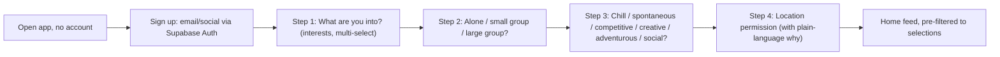
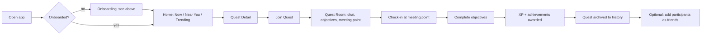
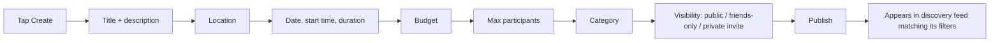
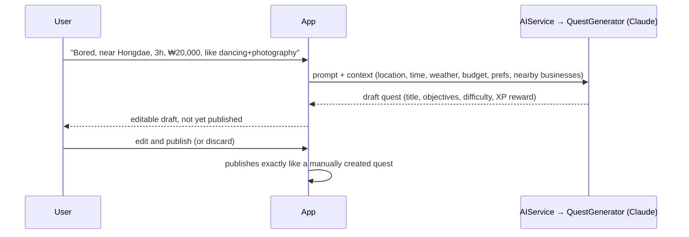
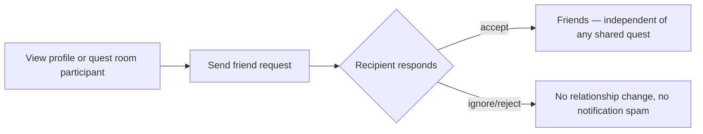
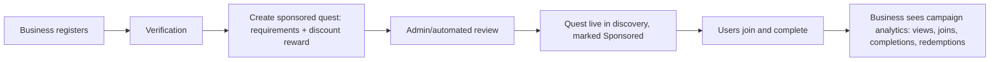
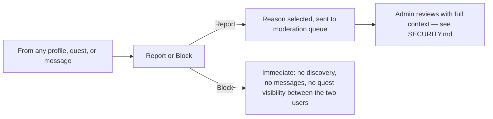

# User Flows — SIDEQUEST

All primary flows target **≤4 steps to value** — a spontaneous-activity app
that requires deliberation up front defeats its own premise.

## 1. Onboarding

Four steps, no required fields beyond what directly improves the first
feed a user sees. Real name, bio, and profile photo are optional and can be
added later from Profile settings.

## 2. Core loop — discover to complete (MVP)

## 3. Quest creation

## 4. AI quest generation *(Phase 3 — architecture reserved now, not built in MVP)*

AI never auto-publishes on a user's behalf — every generation ends at an
editable draft. See [AI.md](AI.md).

## 5. Friend request

## 6. Business sponsorship *(Phase 5)*

## 7. Report / block (safety-critical, always reachable)

